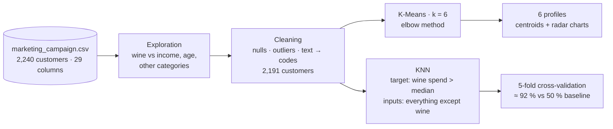
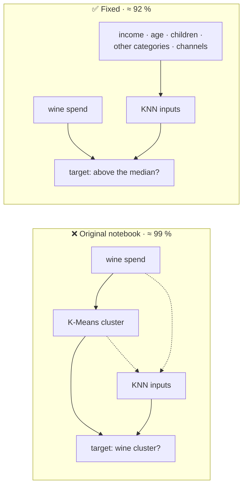

<div align="center">

# Customer Segmentation with Machine Learning

**Who are a store's customers, and can we tell who will spend a lot on wine without looking at their wine purchases?**

K-Means finds 6 spending profiles in 2,191 customers, and a KNN model predicts big wine buyers
from the rest of their profile, evaluated honestly with cross-validation.


| 👥 Customer profiles | 🍷 Predicting big wine buyers | 📏 Honest check |
|:---:|:---:|:---:|
| **6** found with K-Means | **≈ 92 % accuracy** (5-fold CV) vs. 50 % by guessing | data leakage found and fixed |

[**▶ Try the interactive demo**](https://cesarbarrueto0409.github.io/#demo-segmentation) ·
[Open the notebook in Colab](https://colab.research.google.com/github/cesarbarrueto0409/proyecto-MachineLearning/blob/main/Proyecto_Analisis_de_datos_C%C3%A9sar_Barrueto.ipynb) ·
[The 6 profiles](#the-6-profiles) ·
[How the 92 % was measured](#how-the-92--was-measured)



</div>

---

## In 30 seconds

- **Question:** a company wants to aim its marketing better. What kinds of customers does it have, and can it spot the ones who will spend a lot on wine from the rest of their profile (income, family, other purchases, channels)?
- **Approach:** clean a public dataset of 2,240 customers, group them with **K-Means** into 6 profiles, and train a **KNN** classifier to predict big wine buyers.
- **Result:** 6 interpretable profiles, and a classifier that is right **≈ 92 %** of the time on customers it has not seen, where guessing would give 50 %.
- **What I learned the hard way:** the first version of the notebook reported **≈ 99 %**. The model was being given the answer as an input. Finding and fixing that leak is the most valuable part of the project; see [below](#the-leak-and-the-fix).

> Interdisciplinary module project, Universidad de Chile. The notebook is written in Spanish.

---

## Pipeline



| Stage | What was done |
|---|---|
| **Data** | [Customer Personality Analysis](https://www.kaggle.com/datasets/imakash3011/customer-personality-analysis) (Kaggle, public): demographics, income, 2 years of spend in 6 categories (wine, meat, fruit, fish, sweets, gold), purchase channels and campaign responses. |
| **Exploration** | Scatter plots of wine spend against income, age and the other categories to spot outliers and relationships (wine and meat spend move together). |
| **Cleaning** | Drop missing income, keep income under 100k and birth years after 1940, remove meaningless marital labels and one extreme meat value, turn birth year into age, add kids + teens into one `children` column, encode education and marital status as numbers. |
| **Segmentation** | K-Means with k chosen by the elbow method, then profile analysis with centroids and radar charts (marital status, education, children, spend in other categories). |
| **Prediction** | KNN classifier, number of neighbors chosen by error rate, evaluated with cross-validation and a confusion matrix. |

---

## The 6 profiles

Average values per profile (spend is over 2 years, age as of 2024). Names are my interpretation of the averages.

| Profile | Share | Wine | Meat | Income | Age | Children |
|---|---:|---:|---:|---:|---:|---:|
| 🍷 **Wine premium** | 7.4 % | 889 | 476 | 81,407 | 55 | 0.2 |
| **Varied premium shoppers** | 20.1 % | 500 | 418 | 72,301 | 56 | 0.3 |
| **Mid-income wine buyers** | 22.8 % | 499 | 140 | 58,402 | 58 | 1.2 |
| **Small atypical group** | 0.9 % | 177 | 118 | 45,672 | 56 | 1.2 |
| **Older low-spend families** | 23.4 % | 75 | 29 | 42,160 | 60 | 1.6 |
| **Young low-income** | 25.3 % | 25 | 22 | 28,934 | 46 | 0.9 |

**Reading it:** wine spend rises with income and falls with the number of children at home. The top wine buyers are high-income households with almost no children, who also spend a lot on meat. That is a concrete target for a wine campaign.

> **Limitation:** the silhouette score for k = 6 is **0.09**, which means the profiles overlap a lot. They describe spending tendencies, not sharply separated groups. The elbow method alone suggested 6; silhouette by itself would favor fewer clusters.

---

## The leak and the fix

The notebook first defined "wine buyer" as *belonging to the cluster with the highest wine spend*, and then trained the KNN with **wine spend and the cluster number as inputs**. The model only had to read its own answer:



The fixed version:

1. **Target:** a customer is a big wine buyer if their wine spend is above the median. That gives a balanced 50 / 50 split, so 50 % is the score of guessing.
2. **Inputs:** every variable **except** wine spend and the cluster label, standardized so income does not dominate the distance.
3. **Evaluation:** 5-fold stratified cross-validation instead of a single train/test split.

The script that reproduces these numbers is [`evaluation/segmentation_honest.py`](evaluation/segmentation_honest.py), and its aggregated output is in [`evaluation/summary.json`](evaluation/summary.json) (no individual customer rows).

### How the 92 % was measured

<details>
<summary>Accuracy by number of neighbors (5-fold CV)</summary>

<br>

| k | 1 | 3 | 5 | 7 | 9 | 11 | 15 | 21 |
|---|---|---|---|---|---|---|---|---|
| Accuracy | 0.909 | 0.915 | 0.917 | 0.921 | 0.920 | 0.922 | 0.921 | **0.923** |

The result is stable across k, which suggests the signal is real and not a lucky choice of hyperparameter.

</details>

<details>
<summary>Confusion matrix on a 30 % hold-out set (k = 21, accuracy 0.913)</summary>

<br>

| | Predicted: not big | Predicted: big |
|---|---:|---:|
| **Actually not big** | 309 | 20 |
| **Actually big** | 37 | 292 |

Errors are balanced: the model does not get its score by always choosing one class.

</details>

<details>
<summary>Why the original 99 % was misleading</summary>

<br>

Reproducing the original target (membership in the wine cluster) without the leaking inputs still gives ≈ 99 %, but 92.6 % of customers are *not* in that cluster, so always answering "no" already scores 92.6 %. A high accuracy on an imbalanced target says little; that is why the fixed version uses a balanced target and reports the baseline next to the result.

</details>

---

## Repository

```text
proyecto-MachineLearning/
├── Proyecto_Analisis_de_datos_César_Barrueto.ipynb   # Original notebook (Spanish): EDA, K-Means, KNN, radar charts
├── data-raw/
│   └── marketing_campaign.csv                          # Public Kaggle dataset (tab-separated)
├── evaluation/
│   ├── segmentation_honest.py                          # Fixed evaluation: scaled K-Means, leak-free KNN, CV
│   └── summary.json                                    # Aggregated results used in this README
└── docs/pipeline.svg                                   # Animated diagram used in this README
```

## Run it

**Notebook:** use the Colab link above, or open it in Jupyter with `pandas`, `numpy`, `matplotlib`, `seaborn` and `scikit-learn` installed.

**Honest evaluation:**

```bash
pip install pandas numpy scikit-learn
python evaluation/segmentation_honest.py
```

---

<div align="center">

Built by **César Barrueto Alvarado** · Computer Engineering, Universidad de Chile

[Portfolio](https://cesarbarrueto0409.github.io/) · [GitHub](https://github.com/cesarbarrueto0409)

</div>
